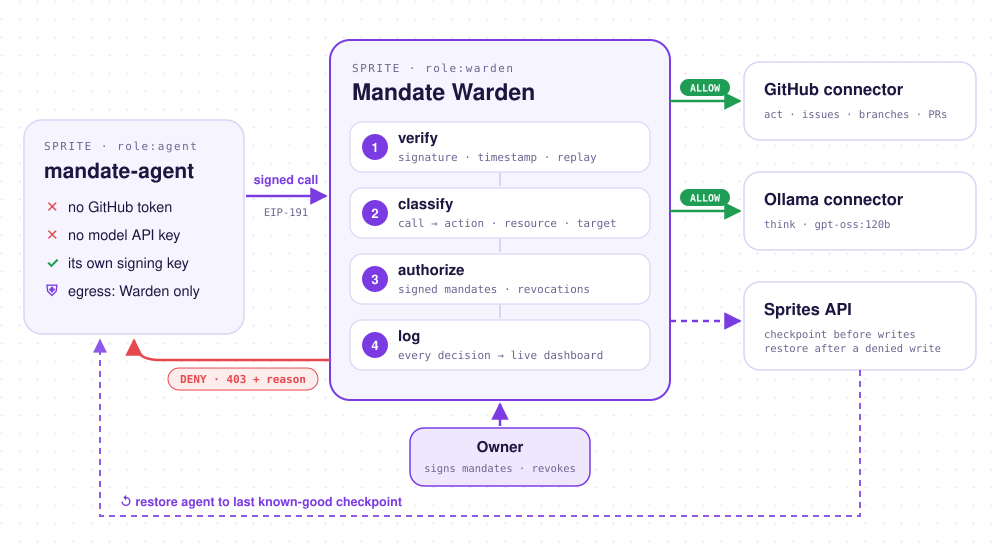

<br/>

<p align="center">
  <a href="https://github.com/1888-Labs/Mandate">
    <picture>
      <source media="(prefers-color-scheme: dark)" srcset=".github/logo-dark.svg">
      
    </picture>
  </a>
</p>

<p align="center">
  A personal agent on a leash: verifiable, revocable authority for AI agents on <a href="https://fly.io/sprites">Fly.io Sprites</a>.
</p>

<br/>

> [!NOTE]
> Built for the Fly.io **Hacksgiving** hackathon (Nov 23–29, 2026). The Warden, the agent, the Sprites integration, the dashboard and the Docker setup were built during the hackathon, on top of Mandate's authorization engine (`mandate-core`, `mandate-crypto`), which predates it.

**The prompt is not the security boundary. Mandate is.**

A personal coding agent runs on its own Sprite. It has no GitHub token, no model API key, and a network policy that only lets it reach one place: the **Mandate Warden**, a second Sprite and the only one allowed to use the Sprites connectors. Every call the agent makes, both to *think* (Ollama) and to *act* (GitHub), is signed with the agent's key. The Warden checks each one against signed, scoped, revocable mandates before forwarding it. Denials come back with a reason (`RECIPIENT_NOT_ALLOWED`, `NO_MANDATE`, `REVOKED`, …). If the agent tries a write it isn't allowed, the Warden can roll its Sprite back to the last known-good checkpoint.

<p align="center">
  <picture>
    <source media="(prefers-color-scheme: dark)" srcset=".github/flow-dark.svg">
    
  </picture>
</p>

## Live

- **Warden dashboard:** [mandate-warden-b4lwr.sprites.app](https://mandate-warden-b4lwr.sprites.app) shows every decision the Warden makes, the mandates in force and the agent's checkpoints. Granting, revoking and restoring need the admin token.
- **Docs:** [1888-labs.github.io/Mandate](https://1888-labs.github.io/Mandate/)
- **Where the agent works:** [dicethedev/mandate-demo](https://github.com/dicethedev/mandate-demo)

## How the leash is enforced

Each layer is enforced by Sprites or by signatures, not by asking the model to behave:

| Layer | What stops the agent |
|---|---|
| Network | The agent Sprite's network policy allows only the Warden's URL. GitHub, model APIs and package registries are unreachable |
| Credentials | The GitHub and Ollama connectors are locked to the Warden Sprite. Called from the agent, they return `403` |
| Identity | Every call is signed with the agent's key (EIP-191). Unsigned or replayed calls are rejected |
| Authority | Each call is checked against signed mandates that lead back to the owner key: action, repository, branch, model, expiry, revocation |
| Recovery | The Warden checkpoints the agent Sprite before allowed writes and can restore it to a known-good checkpoint |

## What it looks like

A real run on the agent Sprite. The owner has granted the agent `model.chat` on `gpt-oss:120b`, read access to the repository, and `contents.write` only on the `agent/work` branch. Asked to edit `main` directly:

```text
$ mandate-agent 'Add a line "Maintained by an agent." to the end of README.md directly on the main branch.'
agent 0x818c…2a90 · model gpt-oss:120b · repo dicethedev/mandate-demo

✓ allow  GET repos/dicethedev/mandate-demo/contents/README.md?ref=main  (HTTP 200)
✗ DENY   PUT repos/dicethedev/mandate-demo/contents/README.md  (HTTP 403)
         Target main is not one of the allowed: agent/work.

The request to update README.md on the main branch was denied by the Mandate Warden:
- Reason: Target branch "main" is not among the allowed branches (only "agent/work" is permitted for writes).
- Mandate decision: RECIPIENT_NOT_ALLOWED.
```

The model call that planned this went through the Warden too, checked against the `model.chat` mandate. Revoke the mandate from the Warden, and the next call is denied with `REVOKED`.

## Run it with Docker

The same Warden runs anywhere. Outside a Sprite there are no connectors, so the Warden holds the GitHub token and Ollama key itself. The agent still holds nothing but its signing key.

```sh
cp .env.example .env                                   # set WARDEN_ADMIN_TOKEN, GITHUB_TOKEN, OLLAMA_URL
docker compose up -d warden                            # dashboard on http://localhost:8080
docker compose run --rm agent warden-call keygen       # put the key in .env as MANDATE_AGENT_KEY
docker compose run --rm agent mandate-agent "List the open issues"
```

The image is `ghcr.io/1888-labs/mandate`. See [self-hosting](docs/self-hosting.md) for granting mandates and running against a local Ollama.

## Crates

| Crate | What it is |
|---|---|
| [`mandate-core`](crates/mandate-core) | Mandates, delegation and the authorization engine |
| [`mandate-crypto`](crates/mandate-crypto) | EIP-191 signing and verification |
| [`mandate-warden`](crates/mandate-warden) | The Warden gateway in front of the Sprites connectors, plus two agent-side binaries: `warden-call` (one signed call) and `mandate-agent` (the agent) |
| [`mandate-cli`](crates/mandate-cli) | Issue, delegate and check mandates from the terminal |

The engine is a plain Rust library with no I/O. Use it to put the same checks in your own gateway: see [using Mandate as a library](docs/library.md).

## Docs

Read them at **[1888-labs.github.io/Mandate](https://1888-labs.github.io/Mandate/)**, or here:

- [Architecture](docs/architecture.md): two Sprites, and how each call is decided
- [The Warden](docs/warden.md): HTTP API, request signing, classification, configuration, and setting up two Sprites
- [Self-hosting](docs/self-hosting.md): the Docker image and Compose, with Warden-held credentials
- [Protocol](docs/protocol.md): mandates, delegation, revocation and deny codes
- [Security](docs/security.md): what's defended and what isn't
- [CLI](docs/cli.md) and [library](docs/library.md)
- [Development](docs/development.md), [roadmap](docs/roadmap.md) and [inspiration](docs/inspiration.md)

## License

MIT
