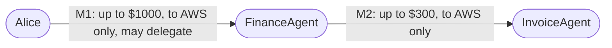

# Mandate

**Verifiable delegated authorization for AI agents, on [Arkiv](https://arkiv.network).**

Give an AI agent narrowly scoped, signed authority. Let it hand a *smaller* piece to another agent. Revoke it any time. Every action gets an answer that explains itself: **ALLOW** or **DENY**, with the reason and the chain of authority behind it.

> **The prompt is not the security boundary. Mandate is.**

| | |
|---|---|
| **Live demo** | *coming soon* |
| **Demo video** | *coming soon* |
| **Arkiv schema** | [`arkiv/schema.md`](arkiv/schema.md) |
| **Arkiv friction report** | [`arkiv/friction.md`](arkiv/friction.md) |
| **Docs site** | *coming soon* (built with [Vocs](https://vocs.dev), from [`apps/docs`](apps/docs)) · [`docs/`](#documentation) on GitHub |

---

## The problem

AI agents now move money, call APIs and delegate work to *other agents*. A system prompt that says "never spend more than $300" isn't a security boundary: prompt injection, bugs and confused agents talk past it. Nobody can answer: *was this agent actually allowed to do this, who allowed it, and has that been revoked?*

## How it works

A **mandate** is a signed grant of authority from one principal (a person or an agent) to another. In this example there are two:

- **M1**: Alice lets FinanceAgent transfer up to $1000, to AWS only, and pass some of that on.
- **M2**: FinanceAgent passes a smaller slice to InvoiceAgent: up to $300, to AWS only.



| InvoiceAgent asks to send | Mandate says | Why |
|---|---|---|
| $200 → AWS | ✅ ALLOW | Within M2, and M2 only narrows M1 |
| $700 → AWS | ❌ `AMOUNT_EXCEEDED` | Its limit is $300 |
| $100 → RandomVendor | ❌ `RECIPIENT_NOT_ALLOWED` | Only AWS is allowed |
| *(Alice revokes M1)* $100 → AWS | ❌ `ANCESTOR_REVOKED` | M2's authority came from M1 |

Three rules make this work:

1. **Authority only narrows.** A delegated mandate can lower limits, drop recipients or expire sooner, but never more than its parent allows. ([protocol](docs/protocol.md))
2. **Everything is signed.** Each mandate and revocation is signed by its issuer with a standard Ethereum key, and the engine re-verifies the whole chain on every check.
3. **Revoking a parent cuts off everything below it**, instantly, with no need to revoke each child.

## Try it

**0. In the browser:** the live app (link above) shows the delegation graph straight from Arkiv, lets you check any action, and has a sandbox where FinanceAgent delegates to a fresh agent you can then revoke. Revocations show up live through Arkiv's entity events. To run it yourself: `scripts/run-local.sh`, then open http://127.0.0.1:8080.

You need [Rust](https://rustup.rs) (stable). For anything on Arkiv, also Node.js ≥ 22.18.

**1. A prompt-injected agent, stopped (no setup):**

```bash
cargo run -p finance-agent
```

The agent obeys an injected invoice email telling it to send $900, then $250 to an attacker. Its payment tool asks Mandate first, so only the real $200 payment goes through. ([details](examples/finance-agent))

**2. The full demo on Arkiv Tiramisu:**

```bash
cp .env.example apps/arkiv-adapter/.env   # add a funded ARKIV_PRIVATE_KEY and an ARKIV_API_KEY
(cd apps/arkiv-adapter && npm install)
scripts/demo-arkiv.sh
```

This signs mandates with the CLI, publishes them to Arkiv through the Rust API, runs every ALLOW/DENY above, revokes M1 and checks that each result is the expected one.

**3. Step by step with the CLI:** see [docs/cli.md](docs/cli.md).

## Why Arkiv

Mandate needs a public record of who granted what, and what was revoked, that **no single operator controls**.

- **Authorship is on-chain.** Each mandate is an Arkiv entity *created by its issuer's own wallet*, so Arkiv's immutable `$creator` *is* the person who granted the authority. Revocations are looked up by `$creator`, so nobody can publish one "from" Alice.
- **Revocations can't be deleted.** They're handed to a burn address in the same transaction that creates them, so not even their author can quietly undo one.
- **Lifetimes match authorization.** Each entity expires when its mandate does, and typed attributes make "active mandates for this agent" a direct query.

With Postgres, every verifier would have to trust the operator, who could hide a revocation. IPFS can't answer live queries. A subgraph would need a contract to index first. **What stays off Arkiv:** private keys, prompts, tool arguments and personal data. Details: [`arkiv/schema.md`](arkiv/schema.md).

## Verify it on Arkiv

- **Network:** Tiramisu (chain `7738577`), [explorer](https://tiramisu.explorer.arkiv.network)
- **Namespace:** every entity has `project_id = "mandate-global-tour-2026"`
- **Live dataset (until 2026-11-07):** an active chain Alice → FinanceAgent → InvoiceAgent, and a revoked mandate for LegacyBot. Every entity key and transaction is in [`arkiv/demo-dataset.json`](arkiv/demo-dataset.json).
- **Wallets:** Alice `0xa090f5ffe81d1603015001563b1d465f6131d2a4` and FinanceAgent `0x21418e3a1c39322e2949f5436966498349a144c4` create the entities (`$creator` = issuer). The funder `0xcE64d2DB165BDdc645A3701c58cF4A4490d0f2FB` only pays their gas. ([all wallets](arkiv/schema.md#wallets))

The query Mandate runs to find a mandate's revocations, published only by its issuer (shown for one mandate; the adapter batches several with `or(...)`, see [`arkiv.ts`](apps/arkiv-adapter/src/arkiv.ts)):

```ts
publicClient
  .select({ key: true, creator: true, owner: true, payload: true })
  .where(and(
    eq("project_id", str("mandate-global-tour-2026")),
    eq("entity_type", str("revocation")),
    eq("mandate_id", bytes32(mandateId)),
    eq("$creator", addr(issuer)),
  ))
```

The on-chain acceptance test, `npm run test:arkiv` in `apps/arkiv-adapter`, creates the demo chain on Tiramisu and checks each property: issuer authorship, revocation filtering by `$creator`, undeletable revocations and read-only mandates.

## Build with Mandate

| You want to… | Read |
|---|---|
| Check an agent's action from any language | [HTTP API](docs/api.md) |
| Grant, delegate and revoke from a terminal | [CLI](docs/cli.md) |
| Embed the engine in Rust | [Library](docs/library.md) |
| Read Mandate's data straight from Arkiv | [Arkiv schema](arkiv/schema.md) |

Protect a tool by asking Mandate before it acts, and only proceeding on ALLOW. That's exactly what the [finance agent's payment tool](examples/finance-agent/src/tool.rs) does.

## Documentation

| | |
|---|---|
| [Protocol](docs/protocol.md) | Mandates, delegation rules, revocation, IDs, signatures, deny codes |
| [Security](docs/security.md) | What Mandate defends against, and what it doesn't |
| [Architecture](docs/architecture.md) | Components, how a decision is made, repository layout |
| [HTTP API](docs/api.md) · [CLI](docs/cli.md) · [Library](docs/library.md) | Using Mandate |
| [Development](docs/development.md) | Building, testing, roadmap |
| [Inspiration](docs/inspiration.md) | Google Zanzibar and related work |
| [Arkiv schema](arkiv/schema.md) · [Friction report](arkiv/friction.md) | Arkiv integration |

## Hackathon

Built for **Arkiv: Global Tour Stop** (tracks: **Security** and **Open Source**) between 12 and 18 October 2026. No pre-existing code was reused. Development was AI-assisted (Claude Code), directed by the author against a written specification.

## License

[MIT](LICENSE)
