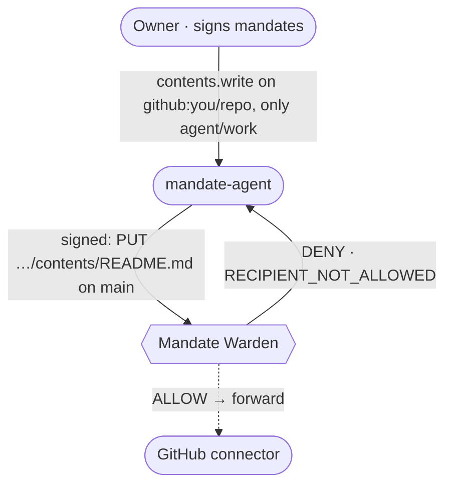

# Concepts in 5 minutes [Everything you need to read the rest of the docs]

Mandate has seven ideas. Learn these and every other page will make sense.

## Principal

**Anyone who can hold or give authority**: you, or an AI agent. Each principal is a standard Ethereum key pair, and its identity is the address (`0x818c…2a90`). There are no accounts or passwords. The agent's key lives only on the agent Sprite, and the owner's key lives only in the Warden.

## Mandate

**A signed grant of authority** from one principal (the *issuer*) to another (the *subject*). It says exactly what is allowed:

| Field | GitHub example | Model example |
|---|---|---|
| action | `contents.write` | `model.chat` |
| resource | `github:you/repo` | `ollama:cloud` |
| allowed targets | only branch `agent/work` | only model `gpt-oss:120b` |
| lifetime | expires in 7 days | expires in 7 days |

The issuer signs it, so nobody can forge or quietly edit it. Think of it as a power of attorney a computer can check on every call.

## Action and target

The Warden turns each HTTP call into an **action** and a **target**, so a mandate can talk about what the call *does*, not its URL. `PUT /repos/you/repo/contents/README.md` with `"branch": "main"` becomes `contents.write` on `github:you/repo` with target `main`. A chat request for `gpt-oss:120b` becomes `model.chat` on `ollama:cloud` with target `gpt-oss:120b`. Anything the Warden doesn't recognise becomes an action no mandate grants. The full table is in [the Warden reference](/docs/warden#how-calls-are-classified).

## Delegation

**Passing on a smaller slice.** If a mandate is delegable, its subject can sign a *child* mandate for someone else, and submit it to the Warden. A child can only ever be narrower: fewer targets, an earlier expiry. Asking for more is rejected before anything is stored. This is how an orchestrator agent can give a sub-agent exactly the slice it needs, and no more.

## Revocation

**Taking authority back**, at any time. A revocation is itself a signed record. Because every check walks the whole chain, revoking a mandate also cuts off everything delegated beneath it, on the very next call. On the dashboard it's one button.

## Decision

**The answer to "may this agent make this call, right now?"** Every call gets:

- **ALLOW**, with the evidence (which mandate, the delegation path), and the call is forwarded; or
- **DENY**, with one stable [reason code](/docs/deny-codes) such as `RECIPIENT_NOT_ALLOWED` or `REVOKED`, a plain-English message, and a `403`. The call never leaves the Warden.

Every decision goes into a log that the [live dashboard](https://mandate-warden-b4lwr.sprites.app/) shows as it happens.

## Checkpoints

**An undo button for the agent.** On Sprites, the Warden can checkpoint the agent Sprite's whole disk through the Sprites API:

- before every **allowed write** (`WARDEN_CHECKPOINT_ON_WRITE`), so any change the agent made around that call can be rolled back; and
- it can **restore** the agent to the last known-good checkpoint after a **denied write** (`WARDEN_RESTORE_ON_DENY`), on the theory that an agent that just tried something it wasn't allowed to may have been compromised.

The owner marks a checkpoint as known-good from the dashboard or with `POST /v1/admin/agent/checkpoint`.

## Next

- [Quick start](/docs/quickstart): run it on Sprites or with Docker
- [Connect your own agent](/docs/connect-an-agent): sign calls from any language
- [Protocol](/docs/protocol): the precise rules
