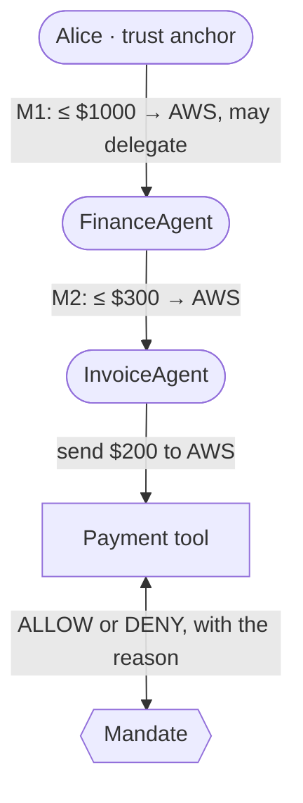

# Concepts in 5 minutes [Everything you need to read the rest of the docs]

Mandate has six ideas. Learn these and every other page will make sense.

## Principal

**Anyone who can hold or give authority**: a person, a company, or an AI agent. Each principal is a standard Ethereum key pair, and its identity is the address (`0xa090…d2a4`). There are no accounts or passwords to manage.

## Mandate

**A signed grant of authority** from one principal (the *issuer*) to another (the *subject*). It says exactly what is allowed:

| Field | Example |
|---|---|
| action | `transfer` |
| resource | `wallet:treasury-demo` |
| limits | at most `$1000`, only to `AWS` |
| lifetime | expires in 48 hours |
| delegable | may the subject pass some of it on? |

The issuer signs it, so nobody can forge or quietly edit it. Think of it as a power of attorney that a computer can check.

## Delegation

**Passing on a smaller slice.** If a mandate is delegable, its subject can issue a *child* mandate to someone else. A child can only ever be narrower: a lower limit, fewer recipients, an earlier expiry. Asking for more is rejected before anything is stored.

:::tip
This is the property that matters for multi-agent systems: authority can flow down a chain of agents, but it can never grow on the way.
:::

## Revocation

**Taking authority back**, by its issuer, at any time. A revocation is itself a signed record. Because every check walks the whole chain, revoking a mandate also cuts off **everything delegated beneath it**, instantly, with no list of tokens to chase down.

## Trust anchor

**Who may start a chain for a resource.** Without this, any agent could sign itself a mandate for your treasury. You tell Mandate, for each resource, which principals own it (for example: Alice owns `wallet:treasury-demo`). A chain whose root isn't a trust anchor is denied with `UNTRUSTED_ROOT`.

## Decision

**The answer to "may this agent do this, right now?"** Every check returns:

- **ALLOW**, with the evidence: which mandate, the full delegation path, and the effective limits; or
- **DENY**, with one stable [reason code](/docs/deny-codes) such as `AMOUNT_EXCEEDED` or `ANCESTOR_REVOKED`, plus a plain-English message.

## Where Arkiv comes in

Mandates and revocations are stored as **Arkiv entities**, each created by its issuer's own wallet. Two Arkiv features do security work:

- **`$creator`** is set by the chain and can't be faked, so "who published this?" is the same as "who granted this?". Mandate only trusts records whose `$creator` is their issuer.
- **Entity Expiration** removes a mandate from Arkiv when it expires, so storage matches authority.

Revocations are handed to a burn address as they are created, so nobody, not even the issuer, can delete one to bring a mandate back. See the [Arkiv schema](/arkiv/schema) for the exact entities and queries.

## Next

- [Integrate in 10 minutes](/docs/integrate): protect your own tool
- [Use cases](/docs/use-cases): where this fits
- [Protocol](/docs/protocol): the precise rules
