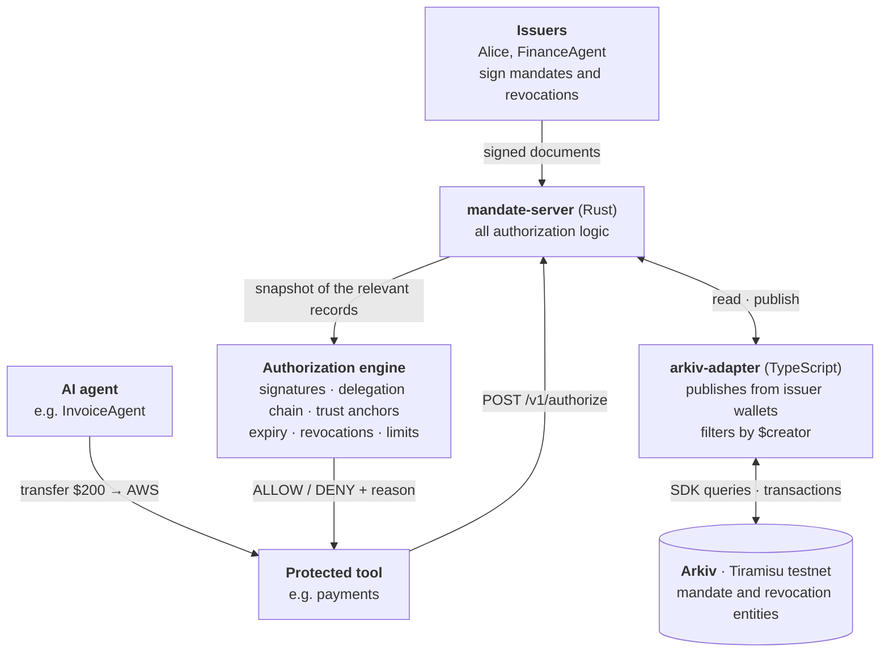
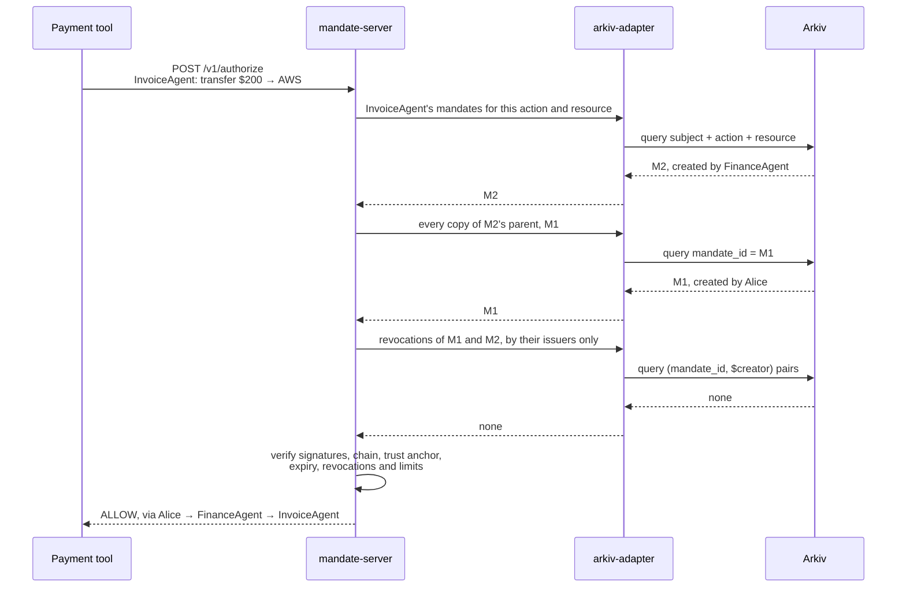

# Architecture

[← Back to the README](../README.md)



Rust owns what authorization *means*. TypeScript only moves records to and from Arkiv, because the official Arkiv SDK is TypeScript.


## How a decision is made



For each request, `mandate-server` fetches from Arkiv the agent's candidate mandates, every copy of each ancestor (one batched query per chain level), and the revocations of all of them published by their issuers (one batched query). It loads them into an in-memory snapshot and runs the same synchronous engine the CLI and tests use. For the demo chain that's three Arkiv queries and about 0.65 s per decision.

- **Fail closed.** If Arkiv can't be read, the answer is `503 STATE_UNAVAILABLE`, never a decision. Anything missing from a snapshot is a denial.
- **No keys on the server.** Clients sign documents themselves; the server verifies them before publishing.
- **Two independent checks on every record:** its on-chain `$creator` must be its issuer, and its signature must verify. See [`arkiv/schema.md`](../arkiv/schema.md).

## Repository layout

```text
mandate/
├── crates/
│   ├── mandate-core/     protocol types, IDs, delegation, revocation, authorization engine (no crypto, no I/O)
│   ├── mandate-crypto/   secp256k1 keys, EIP-191 signing and verification of mandates and revocations
│   ├── mandate-cli/      the `mandate` command
│   └── mandate-server/   HTTP API; decides each request from a fresh Arkiv snapshot
├── apps/
│   └── arkiv-adapter/    TypeScript bridge to Arkiv (stores and queries signed documents)
├── arkiv/
│   ├── schema.md         entities, attributes, queries, what stays off Arkiv
│   └── friction.md       real Arkiv development friction
├── examples/
│   └── finance-agent/    a prompt-injected agent whose payments Mandate stops
└── scripts/
    └── demo-arkiv.sh     the full demo against Arkiv Tiramisu
```

