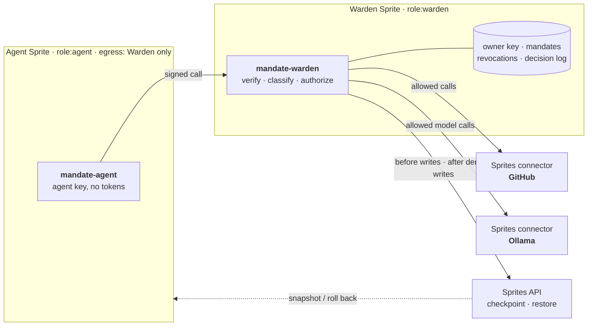
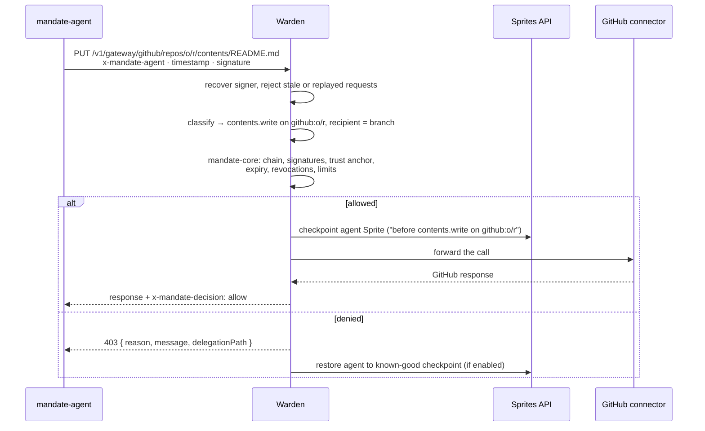

# Architecture

[← Back to the README](../README.md)



The agent and its gatekeeper run on two separate [Fly.io Sprites](https://sprites.dev):

- The **agent Sprite** holds one secret: the agent's own signing key. Its network policy only lets it reach the Warden's URL, so it can't call GitHub, a model, or anything else directly.
- The **Warden Sprite** is the only Sprite allowed to use the connectors, enforced by the connectors' access policy. The connectors attach the real GitHub and Ollama credentials, so even the Warden never sees a token.

The agent's whole world, both what it can *think with* and what it can *do*, goes through one place that checks signed, revocable mandates.

## How a call is decided



1. **Who is asking.** The agent signs each request (EIP-191) over its method, path, timestamp and body hash. The Warden uses the recovered signer as the subject, so an agent can't claim to be someone else. See [Signing a request](warden.md#signing-a-request).
2. **What it's asking for.** The call is classified into an `action`, a `resource` and an optional `recipient`. For GitHub, the recipient is the branch a write lands on. For Ollama, it's the model. Calls it doesn't recognise get an action that no mandate grants. See [How calls are classified](warden.md#how-calls-are-classified).
3. **Is it allowed.** `mandate-core` runs the same engine the CLI and tests use. The Warden's owner key is the only trusted root.
4. **Undo.** Before an allowed write, the Warden can checkpoint the agent Sprite. After a denied write, it can roll the agent back to its last known-good checkpoint. A denial means the agent tried something it shouldn't have, so its local state is no longer trusted.

Every decision, allowed or denied, is appended to `decisions.jsonl` and served at `GET /v1/state`.

## The agent

`mandate-agent` is a short tool-calling loop. It sends the conversation to `api/chat` through the Warden, with one tool, `github_request`. It then runs each tool call through the Warden and feeds the result back, including any denial and its reason. It stops when the model answers without a tool call, or after `MANDATE_MAX_STEPS` steps. The system prompt tells it not to work around denials, but that isn't the security boundary. The Warden is.

## Repository layout

```text
mandate/
├── crates/
│   ├── mandate-core/     protocol types, IDs, delegation, revocation, authorization engine (no crypto, no I/O)
│   ├── mandate-crypto/   secp256k1 keys, EIP-191 signing and verification of mandates and revocations
│   ├── mandate-cli/      the `mandate` command, for local mandates and checks
│   └── mandate-warden/   the Warden gateway, plus two agent-side binaries:
│       └── src/bin/      warden-call (one signed call) and mandate-agent (the agent)
├── docs/                 these docs
└── scripts/
    └── deploy-warden.sh  build and deploy to the two Sprites
```
